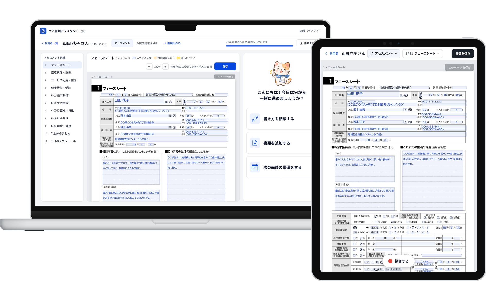
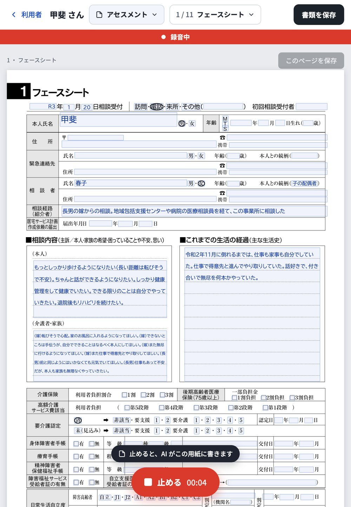
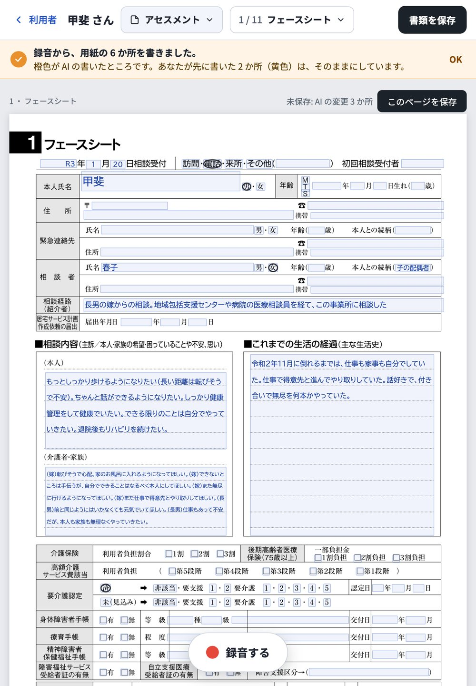
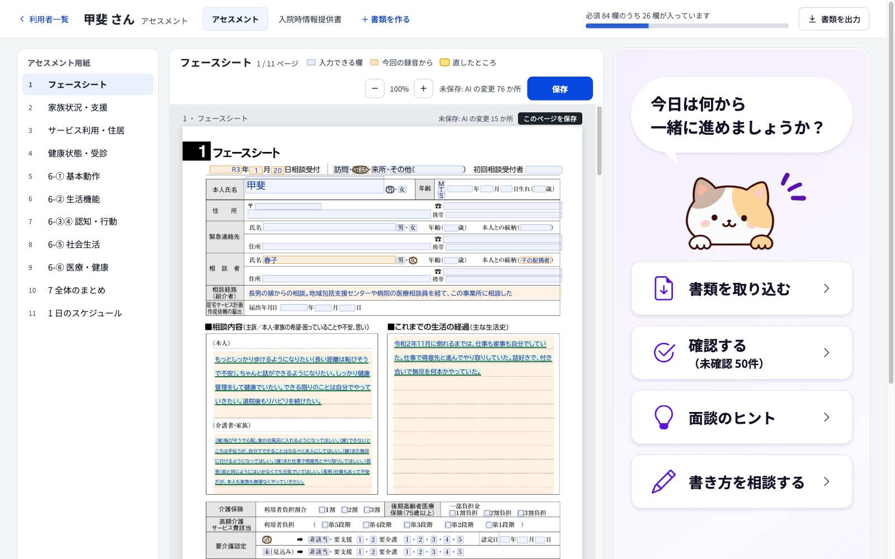
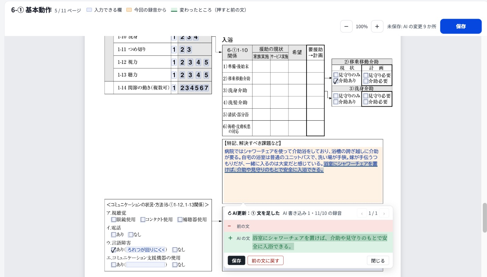
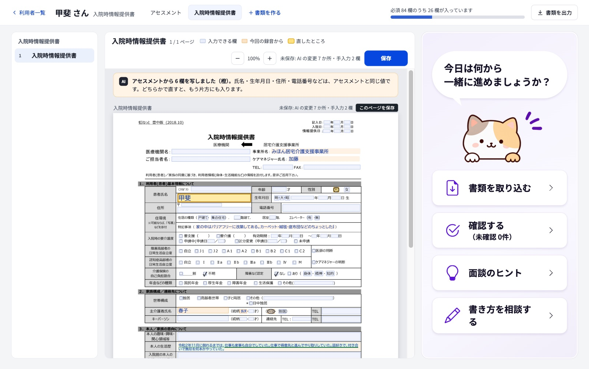
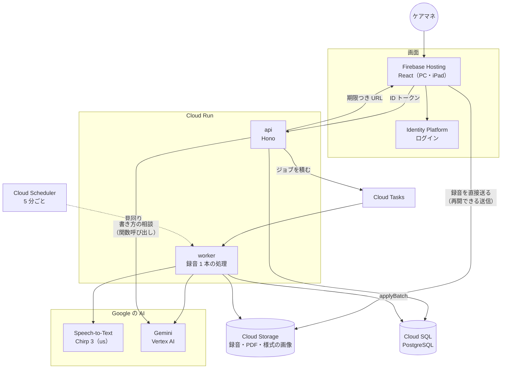
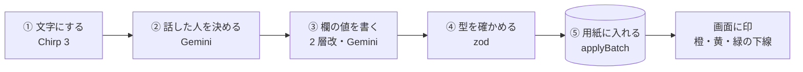

# [wow](https://gen-lang-client-0990270423.web.app)

> **ケアマネジャーが頼る、書類作成の相棒。**
> 面談を録音すると、AI がアセスメント用紙の欄に直接書き込みます。ケアマネは用紙の上で確かめて、違うところだけを直して保存します。一度集めた情報は、入院時情報提供書にも使い回します。書き方に迷ったら、右の猫に相談すると、AI が用紙と録音を読んで書き換えの案を出します。

      



| ① 訪問先で、iPad で面談を録音する | ② 止めると、AI が用紙に書き込む |
| --- | --- |
|  |  |
| **③ AI が書いた欄は橙。用紙の上でそのまま直せる。右の猫が確認と相談を手伝う** | **④ 2 回目の録音で書き足した文は緑の下線。押すと前の文と比べられる** |
|  |  |

**⑤ アセスメントの値を、入院時情報提供書に写す**



画面の利用者「甲斐さん」は、公開の演習シナリオの架空の人物です。①〜⑤ はローカルで、費用のかからない見せかけの AI（`AI_PROVIDER=fake`）で撮りました。

## デモ・関連リンク

| 種別 | URL |
| --- | --- |
| デプロイ URL | **https://gen-lang-client-0990270423.web.app** （ログインが必要です。公開の環境の今の状態は「[既知の制約・未実装](#既知の制約未実装)」） |
| 設計書 | [AI 基盤の設計](docs/AI基盤の設計.md)（録音から欄を書く流れ、作り話の抑え方、評価）ほか。一覧は「[ドキュメント](#ドキュメント)」 |
| 提出用リポジトリ | https://github.com/Devfest-Hackathon-2026/df-2026-t062 |

## チーム情報

| 項目 | 内容 |
| --- | --- |
| ハッカソン | GDGoC Japan DevFest Hackathon 2026 |
| テーマ | Own the Why, Build with Intent. |
| カテゴリ | 医療・福祉 |
| チーム名 | wow |
| プロダクト名 | wow |

### メンバー

| GitHub |
| --- |
| [@takasan1234](https://github.com/takasan1234) |
| [@Masuzawa-Haruka](https://github.com/Masuzawa-Haruka) |
| [@cloud0327](https://github.com/cloud0327) |
| [@sumikanishizawa-sys](https://github.com/sumikanishizawa-sys) |

## プロダクト概要

### 解決したい課題

ケアマネジャー（介護支援専門員）は、本人・家族と、デイサービス・ヘルパー・病院などをつなぐ、在宅介護のまとめ役です。その時間の多くが書類に取られています。中でも重いのは **アセスメント** です。面談で聞いた話を、11 ページ・約 250 項目の用紙に書き写します（丸や ✓ を付ける所まで数えると 1,200 か所を超えます）。

- **現場の声**: 介護の現場の 10 人（ケアマネジャー 5 人・介護職員 2 人・家族介護者 3 人）に話を聞きました。いちばん重いと聞いたのは、面談のあとにパソコンに向かって書類を書く時間でした。最初は「事業所への電話や空き確認を AI が代わる」案を考えていましたが、現場では電話より書類の手伝いが求められていたため、書類作成に切り替えました。
- **公開の調査**: ケアマネジャーの業務の悩みの 1 位は「記録する書式が多く手間がかかる」63.3%（[三菱総合研究所、平成 23 年度 老人保健健康増進等事業](https://pubpjt.mri.co.jp/pjt_related/roujinhoken/jql43u00000001m5-att/h23_04.pdf)、ケアマネジャー 1,868 人、複数回答）。書類ごとの負担感では、アセスメントシートが最も多い 45.0%（[日本総合研究所、平成 28 年度 老人保健健康増進等事業](https://www.jri.co.jp/page.jsp?id=31077)）。

録音を文章にする AI の記録ツールはすでにあります。しかし、次の困りごとが残っています。wow はそこを解きます。

| 残っている困りごと | wow |
| --- | --- |
| AI が作った文章を、書類の欄へコピー＆ペーストしている | AI が **用紙の欄に直接** 書く（文字だけでなく、丸・✓・援助の表の ○△ も） |
| アセスメントで集めた情報が、ほかの書類に流れない | 一度集めた値を **入院時情報提供書に写す**。氏名・住所などは全部の書類で 1 つの値 |
| 言っていないことを AI が書く | **書いてよい範囲を決め、記録と照らし合わせる**。独自のベンチマークで、作り話の数を測る |
| AI に頼むと、知らないうちに記録が書き換わる | 相談の AI は **案を出すだけ**。ケアマネが「用紙に入れる」を押したときだけ入る |

### ターゲットユーザー

**居宅介護支援事業所のケアマネジャー**。訪問先では iPad で録音し、事務所では PC で用紙を確かめて保存する、という使い方を想定しています。

### コア機能

| ID | 機能 | 内容 |
| --- | --- | --- |
| F1 | 録音から用紙へ | iPad で録音して止めると、文字起こし（Speech-to-Text Chirp 3）→ 話した人を決める → Gemini が欄の値を書く → 用紙に入る。その間も用紙は書ける |
| F2 | 用紙の上で直す | アセスメント用紙（11 ページ）と入院時情報提供書を、紙と同じ見た目のまま直す。AI が書いたところは橙、ケアマネが直したところは黄 |
| F3 | ケアマネの欄を守る | ケアマネが書いた・直した欄は、あとの録音でも AI が上書きしない。AI は欄を空にもしない |
| F4 | 書き換えを見せる | 2 回目からの録音で AI が書き換えた文に緑の下線。押すと前の文と比べ、1 か所ずつ保存する・前の文に戻す |
| F5 | 保存と版・PDF | 保存は「1 か所」「このページ」「書類」の 3 段。保存のたびに版を残し、保存した版から PDF を出す |
| F6 | 書類の使い回し | 入院時情報提供書を、アセスメントの値から作る。基本情報の 7 欄（氏名・住所・電話など）は、どの書類で直しても全部に入る。書類の間で食い違う欄は並べて見せ、反映するかを選べる |
| F7 | 書き方の相談 | 右の猫の「書き方を相談する」で、AI に頼む（例:「家族の名前に苗字を足して」「アセスメントから入院時情報提供書に流用して」）。AI は道具（用紙を読む・足りない欄・録音を探す・書き換えの案）を自分で選んで使い、使った道具を作業ログに 1 行ずつ出す。案は − 消える文／＋ 足す文のカードで出し、ケアマネが「用紙に入れる」を押したときだけ入る。入れたあとは「戻す」で戻せる |
| F8 | 作業のお手伝い | 右の猫のメニュー。「確認する」は AI や書類の読み取りで入った欄を、未確認（未保存）と確認済みに分けた一覧、「面談のヒント」は必須の空欄を埋めるために面談で聞くとよい話題。項目を押すと用紙のその欄へ移る |
| F9 | 認定調査票の取り込み（試作） | 猫の「書類を取り込む」で、認定調査票の PDF をブラウザの中で読み、印の付いた選択肢を空欄に仮に入れる。ケアマネが選んで保存した候補だけが用紙に残る（今は 3 項目） |
| F10 | 利用者一覧 | 担当の利用者、要介護度、アセスメントの必須 84 欄のうち入っている数 |

### 使い方（端から端までの流れ）

1. PC でログインし、利用者一覧から利用者を開く
2. 訪問先で、iPad の「録音する」を押して面談する。終わったら「止める」
3. 録音が送られ、文字起こし → AI の書き込みが進む（1 分ほど。iPad を閉じてもよい。その間も用紙は書ける）
4. 書き終わると「用紙の n か所を書きました」と出る。PC で用紙を開き、橙の欄を確かめて、違うところだけ直して保存する
5. 次の面談を録音すると、AI が書き足した文に緑の下線が付く。押して前の文と比べ、保存するか、前の文に戻す
6. 「入院時情報提供書」を作ると、アセスメントの値が写る。入院時情報提供書にしかない欄（本人の意向など）は、猫に「アセスメントから流用して」と相談すると案が出る。確かめて保存し、PDF を出す

デモは、公開の演習シナリオ（病院での面談 → 家屋調査の 2 回）を使います。

## Own the Why — 主な設計判断

AI の提案をそのまま採らず、大事な判断は案を比べて、チームで決めました。詳しい比べ方は [AI 基盤の設計](docs/AI基盤の設計.md) の「決めたこと」と、各設計書にあります。

| 判断 | 採用 | 採用しなかった案 | 理由 |
| --- | --- | --- | --- |
| 何を手伝うか | **書類作成（アセスメントが中心）** | 事業所への電話・空き確認の代行 | 現場で聞くと、電話より書類の手伝いが求められていた |
| AI の書き方 | **2 層改**: 記録から直接欄の値を書き、作り話を抑える 4 つの工夫を足す | 3 層（記録から事実を取り出し、事実を欄に置く）／素の 2 層 | 演習シナリオで採点して比べた。3 層は正しく書けた欄が 2 層の約半分。2 層改は 2 層より正しい欄が少し減る（53 → 48.5）が、作り話が約 3 分の 1（29 → 11.5） |
| ケアマネの確かめ方 | **用紙の上で直して保存する。欄ごとの承認はない** | 欄ごとに「承認」を押す／用紙とは別の入力フォーム | 年配のケアマネに操作を増やさない。いつもの用紙の見た目のまま確かめられる |
| 保存したあとの AI の書き換え | **AI が書いた値は、新しい録音で書き換える（緑の下線で見せる）。ケアマネの値は書き換えない** | 書き換えずに知らせ、ボタンで反映する | 外に出る記録は、どちらの案もケアマネが保存するまで変わらず、安全さは同じ。確かめる操作が 1 回で済む |
| 相談の AI に何をさせるか | **道具を使うエージェントにするが、用紙への書き込みは案まで**。入れるのはケアマネが押したとき | AI が用紙に直接書く・書類を作る | 外に出る記録は、ケアマネが見て決めたものだけにする。案を出せる欄は絞らない（入れるのはケアマネなので安全）。根拠は読んだ用紙と録音の発言だけで、見つからなければ「出ていません」と答える |
| 文字起こし | **Speech-to-Text Chirp 3（us）** | Gemini の文字起こし、他社の音声認識 | 同じ音声で 3 つを比べた予備テスト（10 本・話し手 1 人）で、介護の専門用語を正しく拾えた割合が Chirp 3 は 90%（31 語中 28 語）、ほかは 74% |
| 欄を書くモデル | **Gemini 3.8 Flash（Vertex AI、global）** | Gemini 3.5 Flash（東京） | 東京で使える 3.5 Flash は、3.8 Flash より高く、性能も低い |
| 意味のわからない選択肢 | **AI に書かせない** | 推測で書かせる | 認定調査の選択肢のうち、番号の意味を確かめられなかった 6 項目は、AI が書かない |
| 様式の持ち方 | **欄の意味（`fields.json`）・様式（版つきのデータ）・書類（利用者の値）を分ける** | 様式ごとにプログラムを書く | 新しい様式はデータを足すだけで増やせる。同じ欄の値を、書類をまたいで使い回せる |
| 用紙を変える入口 | **`applyBatch` の 1 つだけ。書類の行を数秒だけ止めて、順に入れる** | AI とケアマネが別々の道で書く | 録音の処理とケアマネの直しが同時に来ても、ケアマネの直しを AI が消さない |
| 録音の送り方と仕組みの数 | **iPad から Cloud Storage へ直接送る（再開できる送信）。Redis・VPC は使わない** | api を通して送る／キューに Redis を置く | 長い録音を api に通さない。部品を減らして、少ない人数で運用できる形にする |

## 使用している Google 技術と選定理由

| サービス | 役割 | 選んだ理由 |
| --- | --- | --- |
| **Speech-to-Text（Chirp 3）** | 録音の文字起こし（日本語、話者の区別、長い録音の一括処理） | 介護の専門用語を最も正しく拾えた（上の表）。長い録音を一括で処理でき、話者を区別できる |
| **Gemini（Vertex AI）** | 話した人を決める、欄の値を書く、書いた値を記録と照らして読み直す。書き方の相談（関数呼び出しで道具を選び、用紙と録音を読んで案を出す） | JSON のスキーマで出力の形を決められる。Vertex AI に送ったデータはモデルの学習に使われない。サービスアカウントで呼べるので、API キーを持たない |
| **Cloud Run** | api（Hono。書き方の相談もここ）と、録音を処理する worker を別のサービスで動かす。DB の移行はジョブ | 時間のかかる録音の処理を、画面の api と分けて動かせる。使わないときは 0 台まで減る |
| **Cloud Tasks** | 録音 1 本の処理を worker に順に渡す | やり直しと、同時に動く数の上限を任せられる |
| **Cloud Scheduler** | 5 分ごとの見回り | 積み損ねた・止まった処理を積み直す |
| **Cloud Storage** | 録音、PDF、様式の画像 | iPad から直接送れる。公開アクセスを止め、画面には期限つきの URL だけを渡す |
| **Cloud SQL（PostgreSQL 17）** | 利用者、書類、欄の値、版、操作の記録 | 書類の行を止めて、同時の書き込みを順に入れられる。IAM 認証でパスワードを持たない。ポイントインタイムリカバリ |
| **Firebase Hosting** | PC・iPad の画面 | ビルドした画面をそのまま配れる |
| **Identity Platform（Firebase Authentication）** | ログインと ID トークン | api は ID トークンだけを確かめればよい |
| **Artifact Registry・Workload Identity 連携** | コンテナイメージ、GitHub Actions からのデプロイ | サービスアカウントの鍵を GitHub に置かずにデプロイできる |

Google Cloud の構成は、すべて Terraform（[`infra/gcp/`](infra/gcp/README.md)）で作ります。

## アーキテクチャ



- **用紙を変える入口は 1 つ**: AI の書き込みも、ケアマネの直しも、同じ書類の行を止めてから入れる。ケアマネが書いた欄は、AI が書き換えない
- **録音は api を通らない**: iPad から Cloud Storage へ直接送り、worker が読む。worker は非公開（呼ぶには IAM の許可が要る）で、Cloud Tasks と Cloud Scheduler は専用のサービスアカウントで呼ぶ
- **鍵を持たない**: Cloud SQL は IAM 認証、Gemini と Speech-to-Text はサービスアカウント、GitHub Actions は Workload Identity 連携

### 録音 1 本の処理



| 段 | 中身 |
| --- | --- |
| ① 文字にする | 発言ごとに id・時刻・話者の記号を付ける。長い録音は長時間の認識で待ち、やり直しでは続きから待つ |
| ② 話した人を決める | 話者の記号を、利用者のまわりの人（本人・家族・専門職）に当てる。新しく出てきた人は覚えて、次の録音でも同じ人にする |
| ③ 欄の値を書く | アセスメントの 23 項目を 7 つのまとまりに分け、まとまりごとに欄の定義と記録を渡して並べて書かせる。記録を指示文の先頭にそろえ、2 つ目からのまとまりは Gemini のキャッシュに当てる。値には根拠の発言の id を付ける。2 回目からは、今の値と新しい録音だけを見せて直させる |
| ④ 型を確かめる | `fields.json` から作ったスキーマで確かめる。選択肢にない値などは落として数える |
| ⑤ 用紙に入れる | 書類の行を止め、今の用紙を読み直してから書く。①〜④ の間にケアマネが直した欄は書かない。止めるのは数秒だけ |

**作り話を抑える 4 つの工夫**（2 層改の「改」）

| 工夫 | 中身 |
| --- | --- |
| 表の列の決まり | 援助の表などで、列の意味を指示文に書く（例: 現状の列に計画を書かない） |
| 読み直し | 書いた値を単位ごとに記録と照らし、根拠のない単位を落とす |
| 2 回目は直すだけ | 新しい録音の発言を根拠にした直しだけを入れる |
| 書類がなければ書類の欄は書かない | 被保険者証などから写す欄は、記録に書類がないときは書かない |

## セキュリティ・スケーラビリティ・保守性

**セキュリティ**
- 確定は「保存」だけ。保存はケアマネが行い、AI は保存できない。PDF は保存した版から作るので、保存していない AI の値は外に出ない
- 書き方の相談の AI は、読む道具と案を出す道具だけを持つ。用紙に書く・保存する・外に送る道具は持たない
- データは事業所ごとに分ける。api の読み書きは、ログインしたケアマネの事業所で絞る
- 録音・PDF・様式の画像は、公開アクセスを止めた Cloud Storage に置く。画面には期限つきの URL だけを渡す
- 鍵を持たない（Cloud SQL の IAM 認証、サービスアカウント、Workload Identity 連携）。秘密の値はリポジトリに入れない
- 保存（Cloud SQL・Cloud Storage）は東京リージョン。ログには録音・文字起こし・値の中身を出さない
- 誰が、いつ、直した・保存した・PDF を出したかを `audit_events` に残す
- このリポジトリには実在の方の情報を入れない（詳しくは「[個人情報の扱い](#個人情報の扱い)」）

**スケーラビリティ**
- Cloud Run は使った分だけ動き、使わないときは 0 台まで減る。録音の処理（worker）は画面の api と別に増やせる
- 録音は iPad から Cloud Storage へ直接送るので、長い録音が api の負担にならない
- 段ごとに結果を残し、やり直しでは済んだ段を飛ばす（文字起こしと Gemini の費用を 2 回払わない）。同じジョブが 2 回届いても、2 つ目は何もしない
- Gemini は 7 つのまとまりごとに並べて呼ぶ（既定で同時に 4）。同じ記録はキャッシュに当て、思考の深さは `LOW` にして、費用を抑える。用紙を止めるのは最後の数秒だけ

**保守性**
- 欄の意味は `core/fields.json` の 1 か所。画面・api・worker が同じものを使う。様式は版つきのデータで、`npm run forms:check` で食い違いを確かめてから登録する
- 独自のベンチマーク（[`eval/bench/`](eval/bench/README.md)）: 公開の演習シナリオの正解で、書くべき欄が正しく書けたかと、作り話の数を採点する。AI を直すたびに点数で比べられる
- テスト: `npm test` 127 件（PostgreSQL を使うものを含む。STT と Gemini は偽物に置き換える）、ベンチマークの採点のテスト 44 件。PR ごとに CI で、型チェック・様式の確かめ・`npm test`・ビルドが走る
- DB の移行は足すだけ。前のリリースに戻しても壊れない

## 技術スタック

| レイヤー | 技術 |
| --- | --- |
| **フロントエンド** | React 19・TypeScript・Vite 8・pdf.js（認定調査票の読み取り） |
| **バックエンド** | Node.js 24（TypeScript をそのまま実行）・Hono・zod 4・node-postgres |
| **AI** | Speech-to-Text v2（Chirp 3）・Gemini 3.8 Flash（Vertex AI）・@google/genai |
| **書類** | pdfme（保存した版から PDF を作る）・様式ごとの欄の位置と対応（`forms/seed/`） |
| **データ** | Cloud SQL for PostgreSQL 17・Cloud Storage |
| **認証** | Identity Platform（Firebase Authentication）・firebase-admin |
| **インフラ** | Cloud Run・Cloud Tasks・Cloud Scheduler・Firebase Hosting・Artifact Registry・Terraform・GitHub Actions（Workload Identity 連携） |
| **テスト・品質** | node:test・Python unittest（ベンチマーク）・TypeScript の型チェック・様式の確かめ（`forms:check`） |

## セットアップ

Node.js は `.nvmrc` の版を使います。ほかに Docker（PostgreSQL）と、`pdftoppm`（様式のページの画像を作る）が要ります。設定は `.env` に書きます（見本は `.env.example`。`.env` は git に入れません）。`npm run dev:api`・`db:*`・`forms:*` は `.env` を自動で読みます（`npm test` は読みません）。

```sh
npm ci
cp .env.example .env                       # 最初に 1 回。DB・ログインのやり方・AI の種類を書く
docker compose up -d                       # PostgreSQL（localhost:54329）
npm run db:migrate                         # 表を作り、様式（forms/seed）を登録する
npm run db:seed                            # 見本のデータ（架空の人と、公開の演習シナリオ）
npm run forms:assets                       # 様式の元の PDF とページの画像を、置き場（.data/storage/forms）に入れる

npm run dev:api                            # ターミナル 1: api（http://127.0.0.1:8787）
npm run dev                                # ターミナル 2: 画面（http://localhost:5173）
```

- 画面を開くとログイン画面になります。ローカルでは、メールアドレス `kato@example.com` だけで入れます（`.env` の `AUTH_MODE=dev` のときだけ）。
- iPad の画面を PC で見るときは、URL に `?ui=pad` を付けます（`?ui=pc` で戻る）。録音のボタンは iPad の画面にあります。
- ローカルでは、録音の置き場は `.data/storage`、ジョブは api と同じプロセスで動きます。AI は `.env.example` のままなら `AI_PROVIDER=fake`（演習シナリオの正解を返す。費用なし）です。

### 見本のデータ

| 利用者 | 状態 |
|---|---|
| 甲斐さん | 演習シナリオの 1 回目の面談のあと。AI が書いた値（橙）が未保存のまま入っている。もう一度録音すると、2 回目の面談（家屋調査）の内容で書き足す |
| 佐藤 一郎さん | 何も入っていない新しい利用者 |
| 山田 花子さん・田中 和子さん | 架空の見本データ（保存済み） |

### 本物の AI で動かす（費用がかかる）

`gcloud auth application-default login` でログインし、`.env` を次のようにしてから `npm run dev:api` を起動し直します。録音するたびに、文字起こし（Chirp 3、us）と Gemini（`gemini-3.8-flash`、global）の費用がかかります（30 分の面談で 100〜150 円ほどの見込み）。

```sh
AI_PROVIDER=vertex
GOOGLE_CLOUD_PROJECT=<プロジェクト>
```

演習シナリオだけで 2 層改を試すときは `node eval/run-writer.ts --out <フォルダ>` を使い、`python3 eval/bench/bench.py score --gold eval/scenario/gold --submission <フォルダ>` で採点します。**実在の方の録音は、Google Cloud の外のサービスに送らないでください。**

### テスト

```sh
npm run typecheck
npm run forms:check        # 様式の版を出す前の確かめ（欄の位置・対応・fields.json の食い違い）
npm test                   # DATABASE_URL があれば DB を使うテストも走る
python3 -m unittest discover -s eval/bench
npm run build
```

様式は DB の版つきのデータです（[DB 設計](docs/DB設計.md)）。`forms/seed/<様式>/` を直したら、`npm run forms:check` で確かめてから `npm run forms:seed` で新しい版を登録し、`npm run forms:assets` で PDF と画像を置き場に入れ、`npm run forms:rebase` で書類の向き先を移します（新しい版が古い版の読んでいた key を全部読むときだけ移します）。対応の書き方は [データの定義](docs/データの定義.md) の「印字欄の対応」。

### デプロイ

PR と `main` で、型チェック、様式の確かめ、テスト（PostgreSQL を使うものも）、ビルド、公開版の確かめ、Docker イメージの確かめを行います（`.github/workflows/ci-cd.yml`）。

| 対象 | やり方 |
| --- | --- |
| 画面（Firebase Hosting） | `Verify` が成功し、`HOSTING_ENABLED=true` のとき、検証済みの `dist/` を `hosting-live-wif` Environment の設定で自動公開する |
| api・worker・DB の移行（Cloud Run） | 手動の workflow（`.github/workflows/cloud-run.yml`、承認つき）。移行のジョブを先に流してから、api と worker を出す |
| Google Cloud の構成 | Terraform（[`infra/gcp/`](infra/gcp/README.md)）。初回の準備（Cloud SQL の `app` ロール、移行）もここに書いてある |

<details>
<summary>Firebase Hosting の初回接続</summary>

1. Firebase プロジェクト `gen-lang-client-0990270423` のデフォルト Hosting サイトを使います。
2. Hosting 専用サービスアカウントに `roles/firebasehosting.admin` と `roles/serviceusage.apiKeysViewer` を付与します。WIF の信頼条件は、開発用リポジトリと所有者の数値 ID、`main`、`ci-cd.yml`、`hosting-live-wif` に限定します。
3. GitHub の `hosting-live-wif` Environment で `main` からのデプロイを許可し、`FIREBASE_PROJECT_ID`、`FIREBASE_HOSTING_URL`、`FIREBASE_WIF_PROVIDER`、`FIREBASE_DEPLOY_SERVICE_ACCOUNT` を登録します。Firebase CLI は短期認証を Application Default Credentials 経由で利用します。
4. `Verify` が成功したら、リポジトリ変数 `HOSTING_ENABLED=true` を設定します。`main` への push で自動公開されます。

</details>

<details>
<summary>切り戻し</summary>

- Hosting: Firebase Console の **Hosting → リリース履歴** で、動作確認済みのリリースに戻します。`/version.json` の SHA で確かめます。
- Cloud Run: `cloud-run.yml` の手順（前のリビジョンにトラフィックを戻す）。DB の移行は足すだけにしているので、戻しても壊れません。

</details>

<details>
<summary>環境変数</summary>

| 変数 | 使うところ | 値 |
|---|---|---|
| `DATABASE_URL` | api・worker（ローカル・CI） | PostgreSQL の接続文字列 |
| `CLOUD_SQL_INSTANCE`・`DB_USER`・`DB_NAME` | api・worker（Cloud Run） | Cloud SQL のインスタンス名と IAM のユーザー（パスワードは持たない） |
| `AUTH_MODE` | api | `firebase`（既定）／`dev`（ローカルだけ） |
| `FIREBASE_PROJECT_ID` | api | ID トークンを確かめるプロジェクト |
| `STORAGE_MODE`・`GCS_SOURCE_BUCKET`・`GCS_OUTPUT_BUCKET`・`GCS_WORK_BUCKET` | api・worker | `gcs` で Cloud Storage。既定はローカル |
| `GCS_FORMS_BUCKET` | api・`forms:assets` | 様式の元の PDF とページの画像の置き場（非公開。画面には期限つきの URL） |
| `LOCAL_SIGNING_SECRET` | api（ローカル） | ローカルの期限つきの URL の署名の鍵。なければ起動のたびに作る |
| `QUEUE_MODE`・`TASKS_QUEUE`・`WORKER_URL`・`TASKS_INVOKER_SA` | api | `tasks` で Cloud Tasks。既定は同じプロセス |
| `AI_PROVIDER`・`GOOGLE_CLOUD_PROJECT`・`GEMINI_MODEL`・`GEMINI_LOCATION`・`STT_LOCATION` | worker | `vertex` で本物の AI。既定は `fake`。Gemini の既定は `gemini-3.8-flash`（`global`）、文字起こしは `us`（Chirp 3 の日本語は東京では使えない） |
| `GEMINI_THINKING_LEVEL` | worker | Gemini の思考の深さ。既定は `LOW`（`MEDIUM`・`HIGH` にもできる。`DEFAULT` でモデルの既定に任せる）。3.8 Flash は `MINIMAL` を受け付けない |

</details>

## 既知の制約・未実装

短い開発期間のため、できたこと・できなかったことを正直に書きます（2026-11-10 の時点）。

**既知の制約**
- **公開の環境**: デモサイトは画面だけが新しい版です。デモサイトの `/api` は、まだ新しい api につながっていません（`/api/health.json` は画面に入れた見本の応答 `source: "mock"` を返します）。Cloud Run の worker・Cloud Tasks・見回りも、公開の環境ではまだ動かしていません
- **本物の AI**: 録音 → 文字起こし → Gemini → 用紙の流れは、ローカルとテストでは見せかけの AI（`AI_PROVIDER=fake`）で確かめています。本物の Speech-to-Text と Gemini の部分は、偽の STT・Gemini を使った単体テストで確かめています
- **様式は 2 つ**: アセスメント用紙と入院時情報提供書。モニタリングとデイの体験用紙は、「書類を作る」のメニューに「後日公開」と出るだけです
- **認定調査票の取り込み**: テキストの入った PDF の 3 項目（移動・食事摂取・排尿）だけ。スキャンした画像は読めません
- **文字起こしの呼び先は us**: Chirp 3 の日本語は東京では断られるようになり、使えるのは us・eu だけのためです（2026-11-10）。音声は東京の置き場から読まれ、結果は東京の DB に入ります
- **書き方の相談の公開の環境**: api に Vertex AI の権限を足す Terraform の反映が済むまで、公開の環境の相談は台本の決まった答えです。本物の Gemini は手元（`AI_PROVIDER=vertex`）で確かめています
- **Gemini の呼び先は global**: 東京で使える Gemini は 3.5 Flash だけのためです。Google は、地域の呼び先でもその地域の中で処理することを保証していません（保証するのは us・eu の呼び先だけ）
- **話した人**: 決められない話者は、記号のまま進めます

**未実装**（決めてあることは [AI 基盤の設計](docs/AI基盤の設計.md) の 11 章）
- **AI が自分で用紙に書く・書類を作る道具**: 書き方の相談の AI は、今は読む道具と案を出す道具だけです。入院時情報提供書は画面のボタンで作ります
- **書類の写しの読み取り**: 被保険者証・主治医意見書などを読み、書類から写す欄を埋める
- **書き込みをまとめて「元に戻す」**（今は長い文章を 1 か所ずつ前の文に戻せる）
- **見直しの候補**: ケアマネの欄と食い違う新しい話が出たときに知らせる
- **介護ソフトへの出力**（現場でいちばん多かった要望。今は PDF だけ）

## AI 活用

- **プロダクトの中**: AI に任せるのは、文字起こし、欄への書き写し、書き方の相談への答えと書き換えの案だけです。確かめる・判断する・保存するのはケアマネです。AI が書いてよい欄は `fields.json` の出どころで決め、ケアマネの判断の欄や、意味を確かめられない選択肢は書かせません
- **評価**: 演習シナリオの正解を AI で下書きし、チームで手分けして確かめて、ベンチマークにしました
- **開発**: インタビューの整理、設計、実装にコーディングエージェント（Claude Code など）を使い、人の時間を現場の聞き取りと判断に回しました。案の比較と最終的な判断はチームで行いました

## ドキュメント

| ファイル | 内容 |
| --- | --- |
| [`docs/AI基盤の設計.md`](docs/AI基盤の設計.md) | 録音から欄を書く流れ、書き換えの決まり、評価、未実装のもの、決めたこと |
| [`docs/データの定義.md`](docs/データの定義.md) | 欄の定義（fields.json）、値の形、印字欄の対応、利用者のデータの持ち方 |
| [`docs/欄の一覧.md`](docs/欄の一覧.md) | アセスメントの欄の一覧（fields.json から作る表） |
| [`docs/DB設計.md`](docs/DB設計.md) | 表と保存の決まり、保存の 3 段、版 |
| [`docs/API設計.md`](docs/API設計.md) | api の道と、誤りの返し方 |
| [`forms/README.md`](forms/README.md) | 様式のデータと、様式を作る道具 |
| [`eval/scenario/README.md`](eval/scenario/README.md) | 公開の演習シナリオと正解 |
| [`eval/bench/README.md`](eval/bench/README.md) | ベンチマーク（採点） |
| [`infra/gcp/README.md`](infra/gcp/README.md) | Google Cloud の構成と、初回の準備 |
| [`AGENTS.md`](AGENTS.md) | Issue とプルリクエストの決まり |

## リポジトリ構成

```
src/        画面（React）。pages/ が画面、form/ が用紙の部品（ページの描画・値の持ち方・録音）、survey/ が認定調査票の取り込み
api/        api（Hono）。ログインの確かめ、置き場（Cloud Storage／ローカル）、ジョブの積み方（Cloud Tasks／同じプロセス）、PDF
worker/     録音 1 本の処理。vertex/ が本物の AI（STT・Gemini・2 層改）、fake.ts が費用のかからない見せかけ
core/       画面・api・worker で共通のもの。fields.json（欄の一覧の本体）、型の確かめ、印字欄と欄の値の変換、文ごとの差分、書き換えの決まり
forms/      様式のデータと道具。seed/<様式>/ を admin/（forms:seed・forms:assets・forms:rebase・forms:check）が DB と置き場に入れる。tools/ は様式を作る道具
db/         PostgreSQL の移行、読み書き（repo.ts）、見本のデータ
eval/       公開の演習シナリオと採点（bench）。run-writer.ts で 2 層改をシナリオに通す
docs/       設計書と画像
infra/gcp/  Terraform（Google Cloud）
test/       テスト（node:test）
```

## 様式の PDF について

様式の元の PDF と、そこから作ったページの画像・座標データは、このリポジトリに入れていません。サービスでは非公開の置き場（Cloud Storage の `forms`）に置き、画面には期限つきの URL で渡します。`npm run forms:assets` が公開されている URL から取ってきます（中身はハッシュで確かめます）。画像がないときは、白い紙の上に欄だけが出ます。

## 個人情報の扱い

- このリポジトリは公開です。入っているのは、公開の演習シナリオ（山梨県介護支援専門員協会の演習用 PDF を写したもの）と、架空の見本データだけです。README の画面写真も、この 2 つだけを使っています。
- 録音・文字起こし・用紙の値は、Google Cloud の東京リージョン（Cloud SQL・Cloud Storage）に置きます。ログには中身を出しません（ジョブの id・段・時間・誤りの種類・使った量だけ）。
- 文字起こし（Speech-to-Text の Chirp 3）は `us` の呼び先、用紙を書く Gemini と書き方の相談の Gemini（Vertex AI）は `global` の呼び先で処理します（理由と注意は「[既知の制約・未実装](#既知の制約未実装)」）。Vertex AI に送ったデータは、モデルの学習には使われません。
- 誰が、いつ、直した・保存した・PDF を出したかを `audit_events` に残します。

## 最終提出

作品が完成したら、公開確認済みのコミットからソース、資料、再現用の設定を取り出します。公開 URL と開発元の SHA を添えて、[運営の提出用リポジトリ](https://github.com/Devfest-Hackathon-2026/df-2026-t062)に提出用 PR を作ります。提出物に秘密情報や開発履歴が含まれていないことを確認します。

## ライセンス

[MIT License](LICENSE)

## 謝辞

GDGoC Japan と DevFest Hackathon 2026 の運営チームの皆さま、メンターの皆さまに感謝します。聞き取りに協力してくださった介護の現場の皆さま、演習シナリオを公開している山梨県介護支援専門員協会に、心から感謝します。
